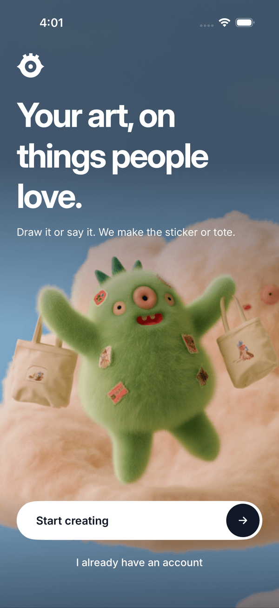
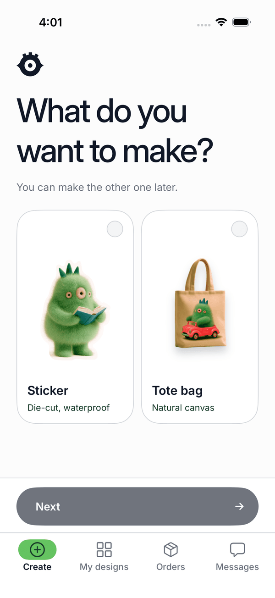
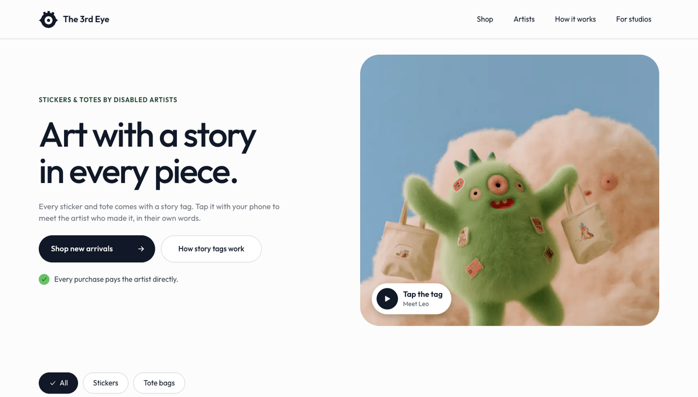

# The 3rd Eye

The 3rd Eye helps artists with disabilities turn their art into products people want to buy. Artists who draw or make things photograph them, and Meta's SAM 3.1 cuts the artwork out. Artists who cannot draw, such as people who are blind, describe an idea out loud: Muse Voice Transcribe 1.0 writes it down, Muse Spark 1.3 shapes it into an image prompt, Muse Image 1.0 draws it, and Muse Spark then describes the result in words, which the phone's screen reader (VoiceOver) reads back so the artist can refine it. The art becomes die-cut stickers and tote bags, and each one ships with an NFC story tag that opens a short captioned video of the artist talking about their work.

This is our entry for the Meta Global AI Developer Hackathon (Startups track, "Build for Your World"). We built it from Oct 27 to Nov 4, 2026, and everything in this repository was written in that period.

## Screenshots

  
  

The iOS shots come from the simulator running against the mock API (`ios/scripts/mock_api.py`); the shop shot is the local dev server. Mascot and sky imagery: The 3rd Eye design team.

## The four problems

1. **Art that can't sell at scale.** Most art studios serving people with disabilities can only sell original pieces locally, and once a piece sells, it's gone. We turn one artwork into products that can be sold again and again, with no inventory.
2. **Talent without income or recognition.** People with disabilities are employed at about half the rate of people without disabilities. We give them a way to earn money and be recognized as artists.
3. **No connection between buyers and creators.** Buyers usually have no idea who made what they're buying. Our NFC story tag lets them hear directly from the artist, which makes the product more meaningful and a better gift.
4. **People who can't draw are left out.** People who are blind or have low vision have visual ideas too, but they can't put them on paper. By describing their idea out loud and letting AI generate the image, they can become creators too.

## What is real and what is staged

Real:
- Every Meta model call in the model map below, on the deployed site and in the iOS app.
- The creator flows (voice, photo, Adjust cutout, listing, story video, thank-you), the shop, the story-tag page, the buyer-to-creator note thread, and the admin pages for print files.
- Print files (PNG and die-cut SVG), generated for every order and downloadable from `/admin`.

Staged or limited:
- **Payments.** Buy creates the order and takes no payment (`PAYMENTS_MODE=staged`).
- **Creators.** The example artists in the shop are fictional and labelled as such. Real creators sign in with a code issued from `/admin`; this is development-grade sign-in, not production auth.
- **Notifications.** The iOS app checks for new orders and messages about every 10 seconds. There are no push notifications.
- **Physical sticker and NFC tag.** Printing, cutting and writing a tag are the physical test before the Nov 2 freeze (steps in `scripts/print_checklist.md`); method: a standard NFC writer app. The iOS app does not write tags. The QR code on `/admin` opens the same story page.
- **Fulfilment.** We print and ship by hand from the admin page.
- **Open-weight stage.** Muse Glimmer runs on our development Mac, so it is only available while that Mac is serving (see below).
- **Not yet verified on a phone:** captions from a camera video on a real iPhone, and a VoiceOver pass over the Adjust cutout and My designs screens. See `docs/risks.md` and `docs/accessibility.md`.

## Model map

| Stage | Model | Id |
|---|---|---|
| Speech to text (spoken ideas, story and thank-you captions) | Muse Voice Transcribe 1.0 | `muse-voice-transcribe-1.0` |
| Shape an idea into an image prompt; describe results; listing agent | Muse Spark 1.3 | `muse-spark-1.3` |
| Generate and refine artwork; product mockups | Muse Image 1.0 | `muse-image-1.0` |
| Find and cut out drawings and handmade objects; combine, add or remove areas; die-cut outline | SAM 3.1 | `sam-3.1` |
| Draft the artist's story from their own words (open weights) | Muse Glimmer 30B via Ollama | `muse-glimmer` |

Muse Code is not used in this project so far. Every model call is recorded in the `ai_calls` table and can be read at `/admin/trace`.

## Open-weight stage

After a story video is captioned, Muse Glimmer drafts the artist's shop story. The artist chooses Use, Edit or Skip, and "Mention my disability" is off by default. Glimmer runs through Ollama on our development Mac (M3 Max); during the demo the app runs against that Mac. Vercel cannot reach Ollama, so on the deployed site the same stage falls back to Muse Spark 1.3, and every response says `provider: "meta-fallback"`.

## Accessibility

- **iOS uses the system's features instead of copying them:** the keyboard's dictation key for speaking instead of typing, VoiceOver for hearing descriptions and messages, Dynamic Type for text size, Increase Contrast for the high-contrast palette.
- **There is no Meta text-to-speech model.** Muse Spark writes the description, both apps show it as text, and VoiceOver reads it on iOS. On the web a "Read aloud" button uses the browser's `speechSynthesis`.
- Everything the app tells the person (questions, confirmations, errors, results) is visible text as well as an announcement.
- Hand-run VoiceOver test scripts for each creator screen are in `docs/accessibility.md`; they have not yet been run on a device.

## Repository

- `web/` - Next.js app: public shop, story-tag pages, admin, and the JSON API used by the iOS app
- `ios/` - SwiftUI creator app (XcodeGen project)
- `design/` - design tokens, the single source of truth for both platforms
- `docs/` - brief, plan, decisions, progress, API contract, runbooks, demo script
- `scripts/` - token generator, seed, probes, repository checks

## Run it

Node 24 and pnpm. From the repository root run `pnpm install`.

**Web** (`web/`):
- `cp .env.example .env.local` and fill what you have. The app builds and the unit tests pass with no keys. With `AI_FIXTURES=1` the AI stages return synthetic offline results (not Meta output) so the screens can be explored without keys.
- `pnpm dev` serves http://localhost:3000. `pnpm build && pnpm start` runs the production build.
- Real runs need `META_API_KEY`, `DATABASE_URL` (Neon Postgres), `CREATOR_SESSION_SECRET`, `ADMIN_PASSWORD` and the Blob settings listed in `docs/architecture.md`. `pnpm db:migrate` then `pnpm seed` creates the schema and the example creators; the seed writes their sign-in codes to `web/.creator-codes.local`, which is not committed.
- For the open-weight stage, run Ollama with the `muse-glimmer` model and set `OLLAMA_BASE_URL`.

**iOS** (`ios/`, Xcode and XcodeGen):
- `xcodegen generate`, then build and run the `The3rdEye` scheme in the simulator. `API_BASE_URL` defaults to the deployed site; pass `API_BASE_URL=http://localhost:3000` to use a local server.
- On a phone: `docs/handoffs/ios.md` ("Install on your iPhone" and TestFlight).

**Mock API for iOS (no backend):** `python3 ios/scripts/mock_api.py` serves port 3999; build with `API_BASE_URL=http://localhost:3999`.

## Test it

- Web: `pnpm test` and `pnpm lint` from `web/`.
- iOS: `xcodebuild test -scheme The3rdEye -destination 'platform=iOS Simulator,name=iPhone 17 Pro' -derivedDataPath build/DerivedData` from `ios/`; UI tests use the mock API as described in `docs/handoffs/ios.md`.
- Repository check: `bash scripts/check_clean.sh`.
- By hand: `docs/accessibility.md` (VoiceOver scripts) and `docs/demo_script.md` (the end-to-end path we record).
- API and architecture: `docs/api.md`, `docs/architecture.md`. Decisions and risks: `docs/decisions.md`, `docs/risks.md`.

Live site: https://the-3rd-eye.vercel.app
