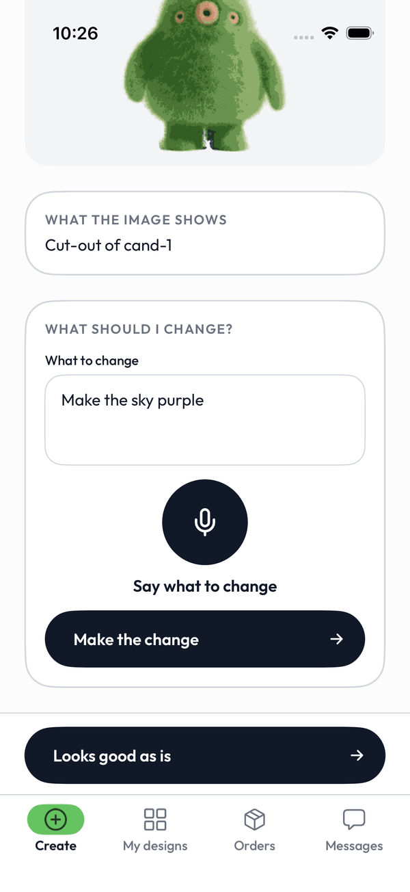
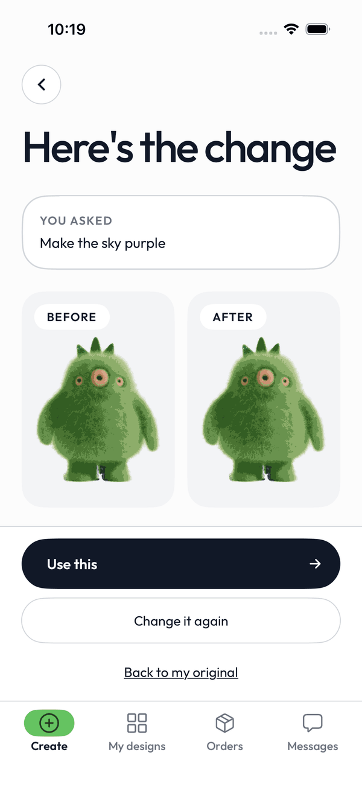

# The 3rd Eye

The 3rd Eye helps artists with disabilities turn their art into products people want to buy. Every piece starts from the artist's own work: they photograph or upload a drawing (or something they made), Meta's SAM 3.1 finds the drawings in the photo, and they pick one. Then they change it until it is theirs. They say what to change (Muse Voice Transcribe 1.0 writes it down) or type it, Muse Image 1.0 edits the picked piece, which it receives as the input image, and Muse Spark 1.3 describes the result in words, so the artist can compare before and after on screen or hear it through the phone's screen reader (VoiceOver). They can change it again, go back to the original, or keep it as is. SAM 3.1 then cuts the final piece out, and it becomes a die-cut sticker or a tote bag. Each one ships with an NFC story tag that opens a short captioned video of the artist talking about their work.

This is our entry for the Meta Global AI Developer Hackathon (Startups track, "Build for Your World"). We built it from Oct 27 to Nov 4, 2026, and everything in this repository was written in that period.

## Screenshots

  
  

The iOS shots (v0.8-rc1) come from the simulator running against the mock API (`ios/scripts/mock_api.py`), with the mascot standing in for the drawing and the change result; the shop shot is the local dev server, captured at 1440 px and shown here at 1200 px. Mascot and sky imagery: The 3rd Eye design team.

## Try it in 3 minutes

1. **Buy something.** Open <https://the-3rd-eye.vercel.app>, pick a sticker, choose a **Size** and a quantity, tap **Add to bag**, fill in the order sheet (name, optional email and note) and tap **Place order**. Payment is staged: the order is created with no charge. The success page shows the story-tag link `/t/<token>`, the page a buyer sees when they tap the sticker's NFC tag. Leave the artist a note there.
2. **Make something.** Open `/create` on your phone (or the iOS TestFlight build) and sign in with the creator code in the submission notes. Pick **Sticker**, then **Take a photo** or **Upload a picture** of a drawing. SAM 3.1 finds the drawings; tap the one you want and **Use this**. On **Change it**, say or type what to change (for example "Make the book red") and tap **Make the change**: Muse Image edits your piece and Muse Spark describes the result on **Before and after** (VoiceOver reads it on iOS). Choose **Use this**, **Change it again**, **Back to my original**, or **Looks good as is** to keep the piece unchanged. SAM 3.1 makes your cutout; fix the edges if you need to, **Use this**, and approve the listing the agent drafts. The product is in the shop.
3. **See the trace.** The admin page (`/admin`, password in the submission notes) lists orders, print files and every model call behind each artwork at `/admin/trace/<artworkId>`.

## The four problems

1. **Art that can't sell at scale.** Most art studios serving people with disabilities can only sell original pieces locally, and once a piece sells, it's gone. We turn one artwork into products that can be sold again and again, with no inventory.
2. **Talent without income or recognition.** People with disabilities are employed at about half the rate of people without disabilities. We give them a way to earn money and be recognized as artists.
3. **No connection between buyers and creators.** Buyers usually have no idea who made what they're buying. Our NFC story tag lets them hear directly from the artist, which makes the product more meaningful and a better gift.
4. **People who can't draw well still can't finish the piece they imagine.** With a photo of a sketch and their voice, they change it until it is theirs.

Source for problem 2: U.S. Bureau of Labor Statistics, *Persons with a Disability: Labor Force Characteristics — 2025* (released 2026-03-03): employment-population ratio for ages 16–64 was 38.1 % with a disability and 74.8 % without. <https://www.bls.gov/news.release/disabl.nr0.htm>

## What is real and what is staged

Real:
- Every Meta model call in the model map below, on the deployed site and in the iOS app.
- The creator flow (photo or upload, Choose a pattern, Change it by voice or text, Before and after, Your cutout, listing, story video, thank-you), the shop, the story-tag page, the buyer-to-creator note thread, and the admin pages for print files.
- Print files (PNG and die-cut SVG), generated for every order and downloadable from `/admin`.

Staged or limited:
- **Payments.** Add to bag opens an order sheet; Place order creates one order (product, size, quantity) and takes no payment (`PAYMENTS_MODE=staged`). The size prices (sticker 3 in = listed price, 4 in +$2, sticker sheet +$6) are sample pricing.
- **Creators.** The example artists in the shop are fictional and labelled as such. Real creators sign in with a code issued from `/admin`; this is development-grade sign-in, not production auth.
- **Notifications.** The iOS app checks for new orders and messages about every 10 seconds. There are no push notifications.
- **Physical sticker and NFC tag.** Printing, cutting and writing a tag are the physical test before the freeze (Nov 3, 9:00 AM) (steps in `scripts/print_checklist.md`); method: a standard NFC writer app. The iOS app does not write tags. The QR code on `/admin` opens the same story page.
- **Fulfilment.** We print and ship by hand from the admin page.
- **Open-weight stage.** Muse Glimmer runs on our development Mac, so it is only available while that Mac is serving (see below).
- **Not used by the apps:** the text-to-image routes (`POST /prompts/shape`, `POST /artworks` with `source: "text2image"`, `POST /artworks/{id}/refine`) remain in the backend, unused since v0.8 and still tested; removing them is a post-hackathon task (`docs/api.md`).
- **Not yet verified on a phone:** captions from a camera video on a real iPhone, and a VoiceOver pass over the Change it, Before and after, Your cutout and My designs screens. See `docs/risks.md` and `docs/accessibility.md`.

## Model map

| Stage | Model | Id |
|---|---|---|
| Speech to text (the spoken change instruction, story and thank-you captions) | Muse Voice Transcribe 1.0 | `muse-voice-transcribe-1.0` |
| Describe each result (Before and after, alt text, what differs from the request); listing agent | Muse Spark 1.3 | `muse-spark-1.3` |
| Edit the picked piece with the change instruction (the piece is the input image); product mockups | Muse Image 1.0 | `muse-image-1.0` |
| Find the drawings in a photo; cut out the picked or changed piece; fix the edges (add or remove areas, draw a box); die-cut outline | SAM 3.1 | `sam-3.1` |
| Draft the artist's story from their own words (open weights) | Muse Glimmer 30B via Ollama | `muse-glimmer` |

Muse Code is not used in this project so far. Every model call is recorded in the `ai_calls` table and can be read at `/admin/trace`.

## Open-weight stage

After a story video is captioned, Muse Glimmer drafts the artist's shop story. The artist chooses Use, Edit or Skip, and "Mention my disability" is off by default. Glimmer runs through Ollama on our development Mac (M3 Max); during the demo the app runs against that Mac. Vercel cannot reach Ollama, so on the deployed site the same stage falls back to Muse Spark 1.3, and every response says `provider: "meta-fallback"`.

## Accessibility

- **iOS uses the system's features instead of copying them:** the keyboard's dictation key for speaking instead of typing, VoiceOver for hearing descriptions and messages, Dynamic Type for text size, Increase Contrast for the high-contrast palette.
- **There is no Meta text-to-speech model.** Muse Spark writes the description, both apps show it as text, and VoiceOver reads it on iOS. On the web a "Read aloud" button uses the browser's `speechSynthesis`.
- **Contrast:** text meets WCAG AA (4.5:1, 3:1 for large text) for every text except the web Welcome title, which sits on a photo by design (about 2.6–2.8:1; recorded with the measurements in `docs/accessibility.md`). The iOS Welcome keeps a scrim behind its text.
- Everything the app tells the person (questions, confirmations, errors, results) is visible text as well as an announcement.
- Hand-run VoiceOver test scripts for each creator screen are in `docs/accessibility.md`; they have not yet been run on a device.

## Repository

- `web/` - Next.js app: public shop, story-tag pages, admin, and the JSON API used by the iOS app
- `ios/` - SwiftUI creator app (XcodeGen project)
- `design/` - design tokens, the single source of truth for both platforms
- `docs/` - brief, plan, decisions, progress, API contract, runbooks, demo script
- `scripts/` - token generator, seed, probes, repository checks

## Run it

Node 24 and pnpm. From the repository root run `pnpm install`.

**Web** (`web/`):
- `cp .env.example .env.local` and fill what you have. The app builds and the unit tests pass with no keys. With `AI_FIXTURES=1` the AI stages return synthetic offline results (not Meta output) so the screens can be explored without keys.
- `pnpm dev` serves http://localhost:3000. `pnpm build && pnpm start` runs the production build.
- Real runs need `META_API_KEY`, `DATABASE_URL` (Neon Postgres), `CREATOR_SESSION_SECRET`, `ADMIN_PASSWORD` and the Blob settings listed in `docs/architecture.md`. `pnpm db:migrate` then `pnpm seed` creates the schema and the example creators; the seed writes their sign-in codes to `web/.creator-codes.local`, which is not committed.
- For the open-weight stage, run Ollama with the `muse-glimmer` model and set `OLLAMA_BASE_URL`.

**iOS** (`ios/`, Xcode and XcodeGen):
- `xcodegen generate`, then build and run the `The3rdEye` scheme in the simulator. `API_BASE_URL` defaults to the deployed site; pass `API_BASE_URL=http://localhost:3000` to use a local server.
- On a phone: `docs/handoffs/ios.md` ("Install on your iPhone" and TestFlight).

**Mock API for iOS (no backend):** `python3 ios/scripts/mock_api.py` serves port 3999; build with `API_BASE_URL=http://localhost:3999`.

## Test it

- Web: `pnpm test` and `pnpm lint` from `web/`.
- iOS: `xcodebuild test -scheme The3rdEye -destination 'platform=iOS Simulator,name=iPhone 17 Pro' -derivedDataPath build/DerivedData` from `ios/`; UI tests use the mock API as described in `docs/handoffs/ios.md`.
- Repository check: `bash scripts/check_clean.sh`.
- By hand: `docs/accessibility.md` (VoiceOver scripts) and `docs/demo_script.md` (the end-to-end path we record).
- API and architecture: `docs/api.md`, `docs/architecture.md`. Decisions and risks: `docs/decisions.md`, `docs/risks.md`.

Live site: https://the-3rd-eye.vercel.app
